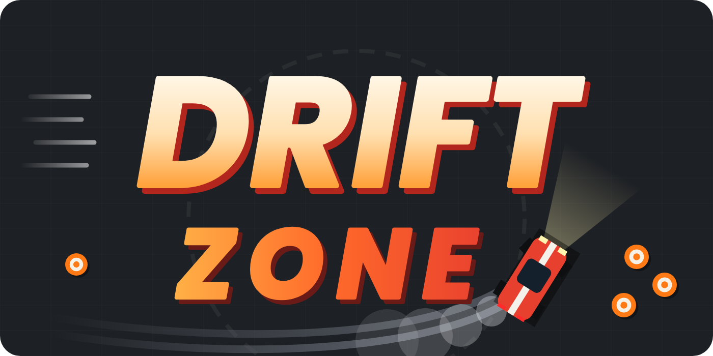

# Drift Zone

A top-down drifting game that runs in your browser. Slide around a huge lot full of cones, tire walls and boulders, chain your drifts for points, turn those points into cash, and spend it on new cars, tuning, paint and map upgrades.

**[Play it here](https://whiffi0375.github.io/Drift-Zone/)** <!-- replace # with your itch.io or GitHub Pages link -->

## Features

- **Real slide physics.** The car keeps its momentum while the nose rotates. Steer harder for a bigger drift angle, flick the other way to transition, and use the handbrake to start a slide.
- **Drift chains.** Keep drifting to build a multiplier up to x10. Banking a chain adds it to your score. Crashing into something solid breaks it.
- **Money.** Every 10 drift points is $1.
- **Six cars** with different power, top speed, grip, steering and nitro.
- **Tuning.** Upgrade engine, steering and nitro tank up to level 5.
- **Paint shop.** Body colors and stripes.
- **Map upgrades.** Minimap radar, extra stars and boost pads, ice patches and double-score zones.
- **Missions.** Three active at a time, with a cash reward for each.
- **Nitro, boost pads, stars and drift gates** to keep things moving.
- **Night mode** with headlights.
- **Sound.** Engine tone and tire squeal, generated in the browser with the Web Audio API.
- **Saves automatically** in your browser (cash, cars, upgrades, stats).
- **PC and mobile.** Keyboard controls or on-screen touch buttons, with a switch button.

## Game modes

| Mode | What it is |
|---|---|
| Career | Drift, earn cash, buy cars, tune and upgrade the map. |
| Time attack | 90 seconds to score as much as you can. Score still converts to cash. |
| Sandbox | Infinite nitro, no money earned. Set power, top speed, grip, steering and nitro to anything, change colors, spawn cones and toggle night mode. |

## Maps

- **Classic Lot.** Boulders, tire walls, roaming boulders, cone slaloms, ice and gate courses.
- **Cone Valley** ($25,000). Only cones, no solid obstacles, with lots of stars and double zones. It has its own upgrades to unlock more stars, more zones, bigger cone payouts and triple zones.

## Controls

| Action | PC | Mobile |
|---|---|---|
| Gas / brake | W S or Up Down | On-screen buttons |
| Steer | A D or Left Right | On-screen buttons |
| Handbrake | Space | DRIFT |
| Nitro | Shift | NOS |
| Garage | B | $ |
| Night mode | N | |
| Mute | M | |
| Respawn | R | |
| Pause | Esc | II |

Use the **Controls: PC / Mobile** button to switch.

## Tips

- Build speed, steer hard and tap the handbrake to start a drift.
- Hold gas to keep the slide wide. Lift off to tighten it.
- Drifting refills your nitro. Stars refill it faster.
- Slide through gold zones for bonus points and through magenta gates while drifting for a gate bonus.

## Run it locally

There is nothing to install or build. The whole game is one HTML file.

1. Download `index.html`.
2. Open it in a modern browser.

## Tech

- Plain HTML, CSS and JavaScript in a single file
- Canvas 2D for rendering
- Web Audio API for sound
- `localStorage` for save data
- No dependencies and no network requests

## Roadmap

- Rival AI cars and ghost runs
- Weather and surface types
- More maps
- Achievements
- Underglow and more cosmetics

## License

Add a license before publishing. MIT is a common choice for small games like this.
